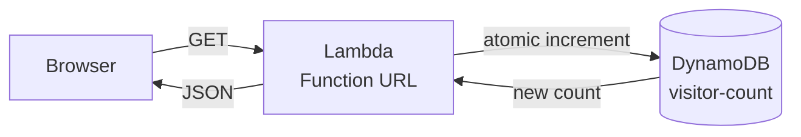
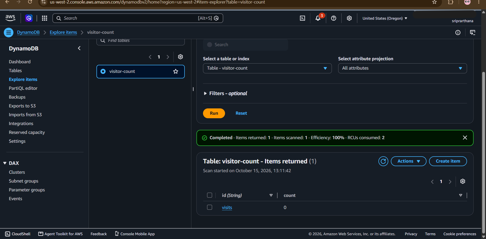
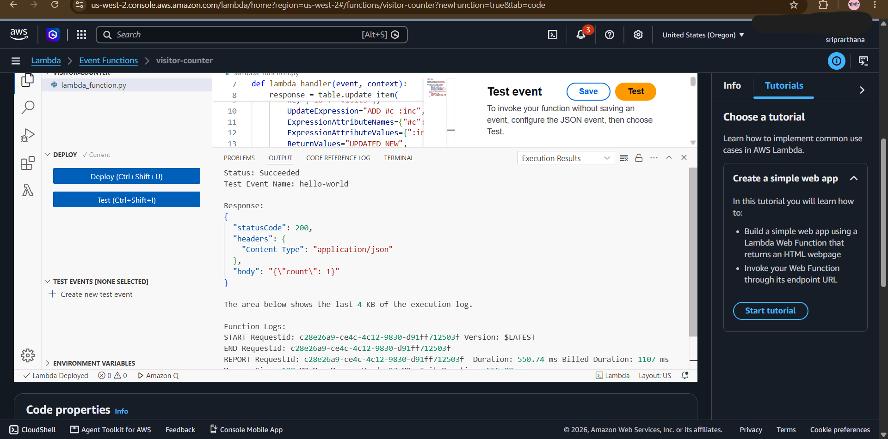
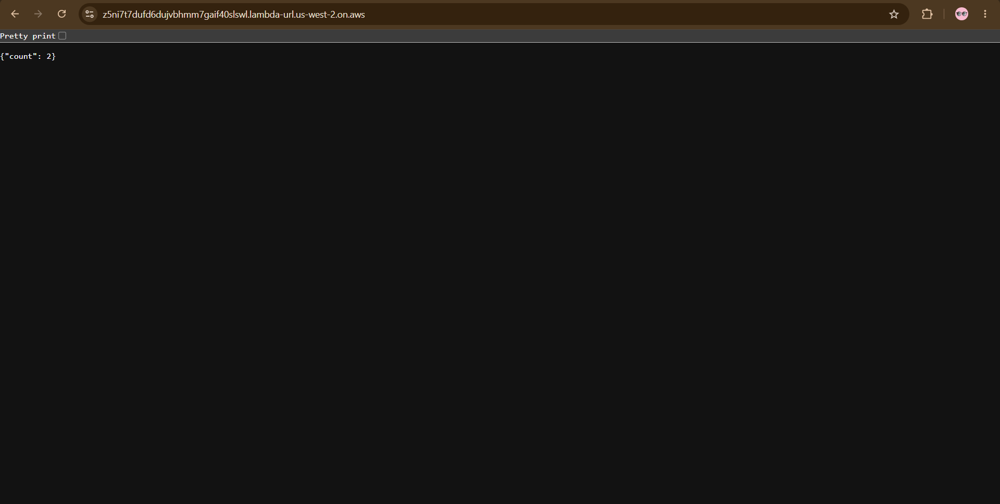
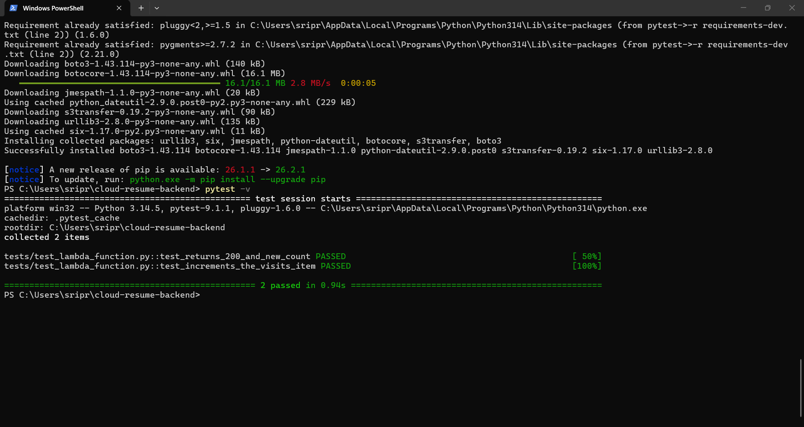
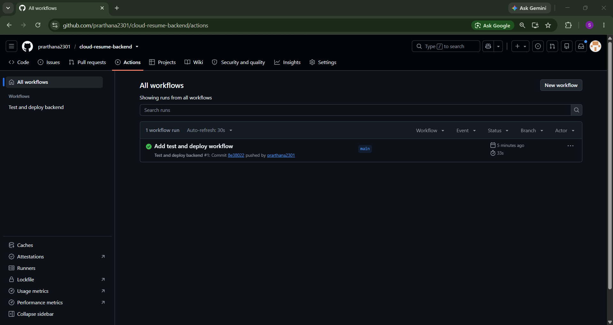

# Cloud Resume Challenge: Backend

The visitor counter API for my [portfolio](https://d2yykngnx1qihy.cloudfront.net): a Python Lambda that increments a number in DynamoDB and returns it.

Related repos:
- [cloud-resume-frontend](https://github.com/prarthana2301/cloud-resume-frontend): the site and its deploy pipeline
- [cloud-resume-infra](https://github.com/prarthana2301/cloud-resume-infra): Terraform for the whole stack

## How it works



- `src/lambda_function.py` updates the `visits` item with an `ADD` expression, so two visitors at the same moment can't overwrite each other's count
- The Function URL allows requests only from my site's domain (CORS)
- The Lambda role can only run `dynamodb:UpdateItem` on one table

## Tests and deployment

- `tests/` has pytest tests that replace DynamoDB with a mock, so they run anywhere with no AWS access
- On every push to `main`, GitHub Actions runs the tests first, and **only if they pass** it packages `src/` and updates the Lambda
- GitHub signs in to AWS with short-lived OIDC credentials, and the deploy role can only update this one function

```
pip install -r requirements-dev.txt
pytest -v
```

## Screenshots

| DynamoDB item | Lambda test |
|---|---|
|  |  |

| API response | Tests passing |
|---|---|
|  |  |



## What I learned

- Mocking AWS calls makes tests fast and free, and the pipeline blocks a deploy when a test fails
- Pipelines get short-lived credentials through OIDC, so there are no AWS keys stored in GitHub. While setting this up on the frontend, I found that GitHub's token includes numeric owner and repo IDs in its `sub` claim, and I used that format for this role from the start.
- Least privilege in practice: each role gets only the actions on the one resource it needs

## Next steps

- Count unique visitors instead of every page load
- Add CloudWatch alarms for errors
- Add rate limiting in front of the function URL